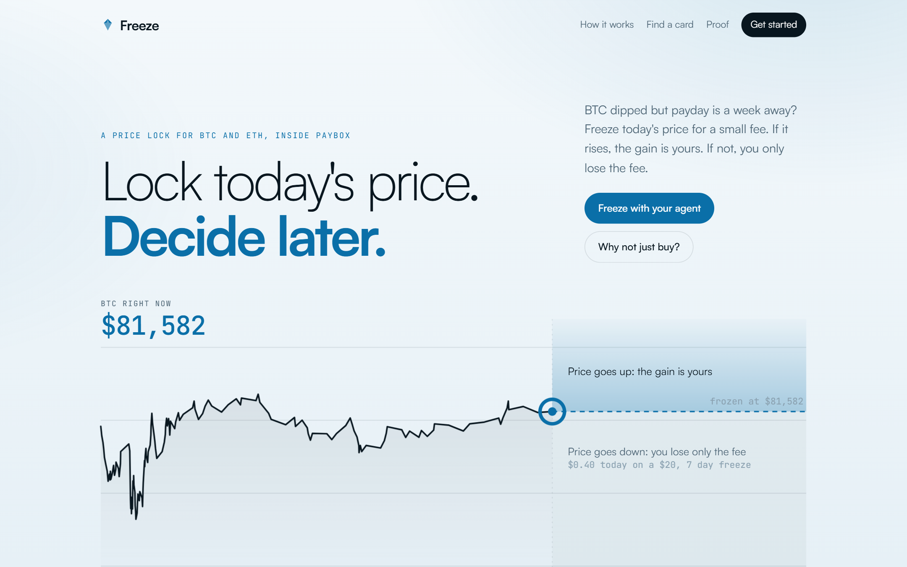
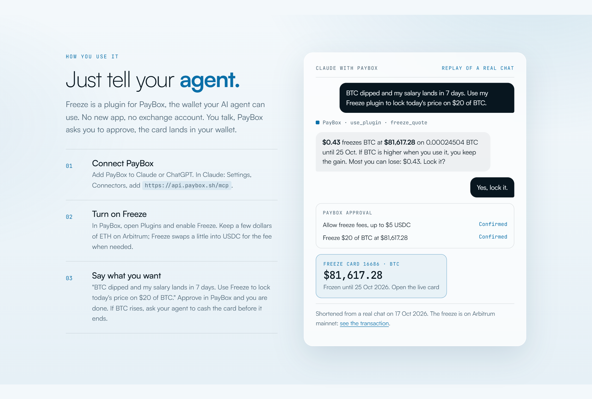
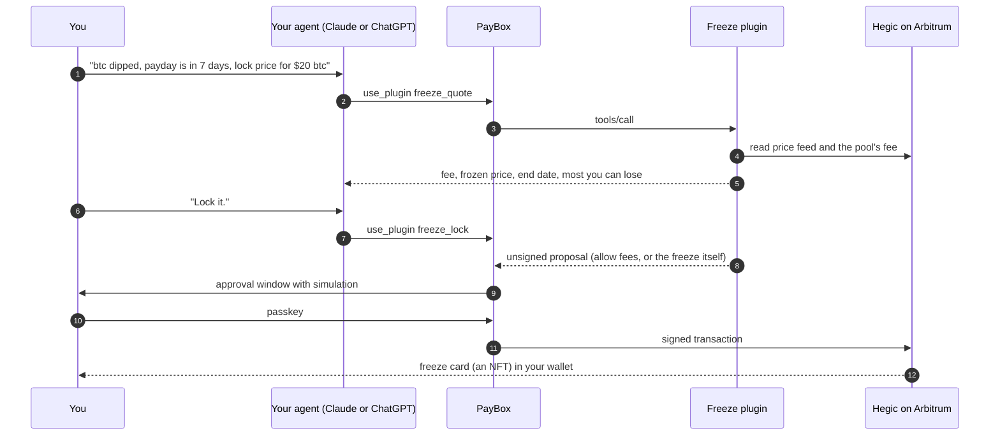

<p align="center">
  
</p>

<h1 align="center">Freeze</h1>

<p align="center">
  <b>Lock today's price. Decide later.</b><br>
  BTC dipped but payday is a week away? Ask your agent to freeze today's price for a small fee. If it rises, the gain is yours. If not, you only lose the fee.
</p>

<p align="center">
  <a href="https://freeze-paybox.vercel.app"></a>
  <a href="https://freeze-paybox.vercel.app/proof.html"></a>
  <a href="https://github.com/jenzylove/freeze/actions/workflows/verify.yml"></a>
  <a href="https://developer.paybox.sh"></a>
  <a href="https://x.com/Dollar782/status/2111512033762111718"></a>
  <a href="LICENSE"></a>
</p>

<p align="center">
  
</p>

Most people who watch BTC dip can't buy it that day. The money is in next week's salary, in a
locked savings plan, or simply not here yet. By the time it lands, the dip is gone.

Exchanges answer this with options, which most people will never open. Freeze puts the same
protection behind one sentence to the agent you already use. You pay a small fee now, and the price
you saw is yours until the end date. If BTC rises, you collect the gain as if you had bought at
the frozen price. If it falls, the fee is the most you can lose.

Freeze is a [PayBox](https://developer.paybox.sh) plugin. PayBox is MoonPay's wallet for AI agents
in Claude and ChatGPT, so there is no new app, no exchange account and no seed phrase: you talk,
PayBox asks you to approve, and the freeze card lands in your wallet.

## Start here

| | |
|---|---|
| Live site | https://freeze-paybox.vercel.app |
| Demo video | [Watch on X](https://x.com/Dollar782/status/2111512033762111718) |
| Every freeze and how it ended | [Board](https://freeze-paybox.vercel.app/board.html), wins and losses, updated by the keeper |
| Real freezes on Arbitrum mainnet | [Proof page](https://freeze-paybox.vercel.app/proof.html), cards [16686](https://freeze-paybox.vercel.app/card.html?id=16686) and [16685](https://freeze-paybox.vercel.app/card.html?id=16685) |
| The freeze from one chat message | [`0x28538aa5…1afc`](https://arbiscan.io/tx/0x28538aa56aa35300f67740f1afc0a14136abc1fb49a1ba77ab72c64b28411afc) |
| How to use it | [Three steps](#use-it-in-three-steps) |
| Plugin source | [`plugin/src/plugin.ts`](plugin/src/plugin.ts), math in [`plugin/src/core.ts`](plugin/src/core.ts) |
| Build log | [`docs/BUILD_LOG.md`](docs/BUILD_LOG.md) |

## Judge fast path (five minutes, no keys)

1. Open https://freeze-paybox.vercel.app. The chart is BTC's last day of real price updates read
   from Arbitrum, and the dashed line is today's price, frozen. The fee under it is live.
2. Scroll to **Why not just buy?** and drag BTC to -10%. Buying $500 loses $50. Freezing $500 loses
   only today's fee, about $10.
3. Open [card 16686](https://freeze-paybox.vercel.app/card.html?id=16686). It was bought on mainnet
   from one message in Claude: *"hey chat, btc dipped today but payday is in 7 days can you pull up my freeze plugin so i lock price for $20 btc"*. Claude found Freeze in the user's plugins by
   itself. Everything on the card is read live from the chain.
4. Open the [proof page](https://freeze-paybox.vercel.app/proof.html) and follow any step to
   Arbiscan.

With PayBox connected to Claude and Freeze enabled, the same sentence runs it for real.

<p align="center">
  
</p>

## Freeze or buy?

| Example: $500 of BTC for 7 days | Buy today | Freeze today |
|---|---|---|
| Money needed today | $500 | about $10 (live fee) |
| BTC falls 10% | you lose $50 | you lose the fee, about $10 |
| BTC rises 10% | you gain $50 | you gain $50 minus the fee |

Buying is better when the money is already here and you are sure. Freeze is for when it isn't
here yet, or when you want the rise without carrying every drop.

**The business in one number:** freezing $500 of BTC for a week costs about 2% of the amount today,
instead of the full $500 up front.

## Use it in three steps

1. **Connect PayBox** to Claude or ChatGPT. In Claude: Settings, Connectors, add
   `https://api.paybox.sh/mcp`.
2. **Turn on Freeze** in PayBox under Plugins. Pay the fee from USDC on Solana, USDC on Base or ETH
   on Arbitrum. Your agent moves just the few dollars the fee needs.
3. **Say it.** "Use Freeze to lock today's price on $20 of BTC for a week." Approve in PayBox. Cash
   the card whenever you like. If it wins and you forget, auto cash pays you in its last 6 hours.

The first freeze from a wallet takes up to four approvals (bring the fee over, allow fees, turn on
auto cash, freeze). After that, each freeze is one approval.

## New in v0.2

- **Pay from where your money is.** `freeze_fund_solana` and `freeze_fund` with `from: "base"` move
  just the fee, plus a little ETH for network fees, from your PayBox wallet on Solana or Base to
  Arbitrum through [Relay](https://relay.link). One approval from Solana.
- **Auto cash.** [`FreezeAutoCash`](contracts/src/FreezeAutoCash.sol) cashes a winning card in its last
  6 hours and always pays the card's owner. No admin, no upgrade, holds no money. A keeper on GitHub
  Actions calls it every 30 minutes and pays the gas.
- **Every freeze in public.** The [board](https://freeze-paybox.vercel.app/board.html) lists every
  freeze bought through Freeze and how it ended, losses included.
- Cashed cards now show as cashed everywhere, and reads fall back to a second RPC when Arbitrum's
  public one is busy.

## How it works



Under the hood a freeze is a call option bought from [Hegic](https://www.hegic.co)'s pool on
Arbitrum. The card stores the amount and the frozen price. Its value at any moment is
(price now minus frozen price) times the amount, and only its owner can cash it.

### Tools

| Tool | What it does | Moves money |
|---|---|---|
| `freeze_quote` | Live fee, frozen price, end date and break even for a dollar amount | No |
| `freeze_lock` | The one tool needed to freeze. Returns whichever step is missing: swap a little ETH for the fee, allow fees, turn on auto cash, or the freeze itself. With no money on Arbitrum it tells the agent how to pay from Solana or Base | Yes, with approval |
| `freeze_fund_solana` | Moves the fee from USDC on Solana to Arbitrum through Relay, in one Solana transaction | Yes, with approval |
| `freeze_cards` | Your cards, what each is worth now, when each ends, whether auto cash is on, and a link to its live page | No |
| `freeze_use` | Cash a card that is worth something, paid to the owner in USDC | Yes, with approval |
| `freeze_gift` | Send a card, and everything it is worth, to someone else | Yes, with approval |
| `freeze_fund` | Gets fee money on Arbitrum from USDC on Base (through Relay) or from ETH on Arbitrum | Yes, with approval |
| `freeze_auto_cash` | Turns auto cash on or off for the wallet | Yes, with approval |
| `freeze_approve` | The fee allowance on its own | Yes, with approval |

Every money tool returns an unsigned `io.paybox/transactionProposal`. The wallet address comes from
PayBox as the `sender` argument, so a user never types it.

## What is real

| Part | Status |
|---|---|
| Plugin in PayBox | Live in the PayBox Community Plugins marketplace, 9 tools, starter conformance passing |
| Auto cash contract | [`0x6793…36Ec`](https://arbiscan.io/address/0x679399608d973c2476d1D9ECd8eB1150e97936Ec) on Arbitrum, 6 fork tests against live cards (`forge test` in `contracts/`) |
| Freezes on Arbitrum mainnet | 2, both made through PayBox with real money: [card 16686](https://arbiscan.io/tx/0x28538aa56aa35300f67740f1afc0a14136abc1fb49a1ba77ab72c64b28411afc), [card 16685](https://arbiscan.io/tx/0x6c819fea4aa0059b7514a8f97380193c1b03b1e93b2604367f31b533fe73893f) |
| Payout | Tested on a fork of mainnet: price moved to $2,900, card paid 19.25 USDC, a stranger was refused ([spike notes](docs/spikes/hegic-engine.md)) |
| Prices and fees on the site | Read live from Arbitrum on every load, never stored |
| Reminder before a card ends | Calendar file from the card page, and auto cash in the last 6 hours |

## Scope

BTC freezes run 7 to 14 days and ETH freezes 60 to 90 days, the terms Hegic's pool sells. Amounts
run from $2 to $500 per freeze, on Arbitrum. A card pays nothing after its end date, which is what auto cash is for. See
[SECURITY.md](SECURITY.md) for the contracts involved and the risks a user takes.

## Run it locally

The PayBox starter needs Linux or WSL with Node 24 and pnpm 11.

```bash
cd plugin
pnpm install
node --test "test/*.test.ts"    # pricing, payout and calldata math
pnpm test                       # typecheck, two identical builds, PayBox conformance
node scripts/call.mjs freeze_quote '{"asset":"BTC","usd":20,"days":7}'
```

`scripts/one-ask.mjs` replays a full first freeze (swap, allow, freeze, then a second one step
freeze) against a local `anvil --fork-url https://arb1.arbitrum.io/rpc --port 8546`.

The site in `web/` is static HTML and needs no build.

## Layout

```
plugin/     PayBox plugin (MCP server bundled to dist/plugin.mjs)
contracts/  FreezeAutoCash and its fork tests (Foundry)
keeper/     auto cash keeper and board publisher, run by .github/workflows/keeper.yml
web/        the live site: landing page, board, card page, proof page
docs/     PRD, plan, build log, spikes
```

MIT licensed.
